# TP3 – Serveur Multi-threads TCP

## 1. Objectif

Créer un serveur Java capable de gérer plusieurs clients en même temps grâce aux threads et aux sockets TCP.

## 2. Les classes

- **ServeurMT.java :** accepte les connexions et attribue un numéro à chaque client.
- **ClientProcess.java :** envoie le numéro du client.
- **Client.java :** se connecte au serveur et affiche le message reçu.

## 3. Exécution

1. Démarrer le serveur `ServeurMT`.
2. Exécuter plusieurs fois le client `Client`.
3. Le serveur affiche les informations de chaque client.
4. Chaque client reçoit son numéro de connexion.
## 4. ServeurMT:
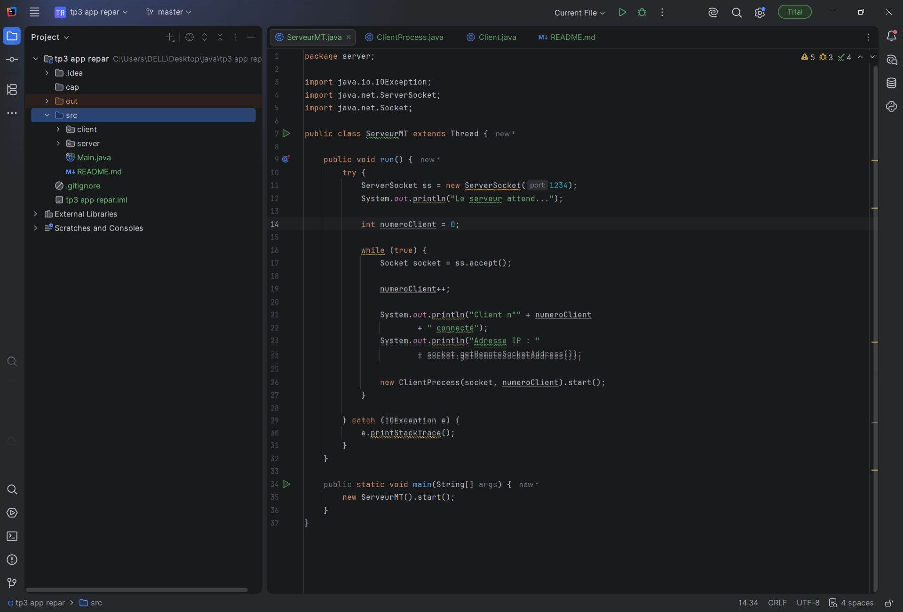

## 5. ClientProcess.java:
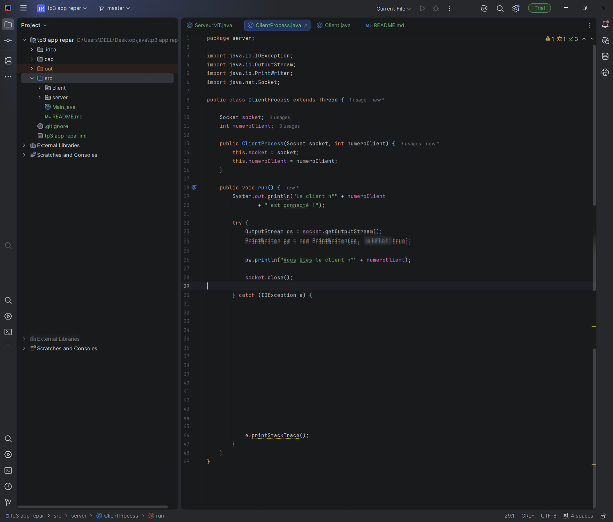

## 6. Client:
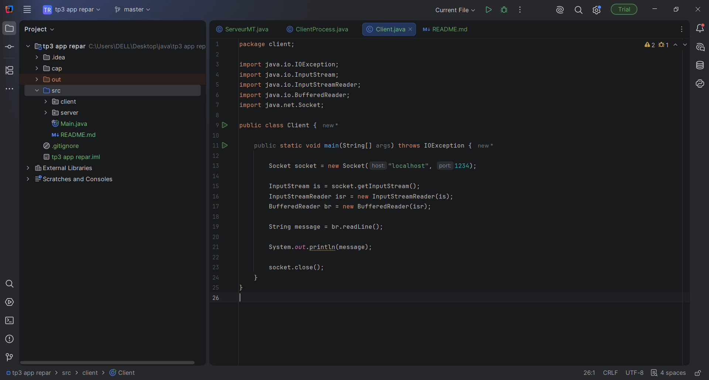

## 7.resultats:
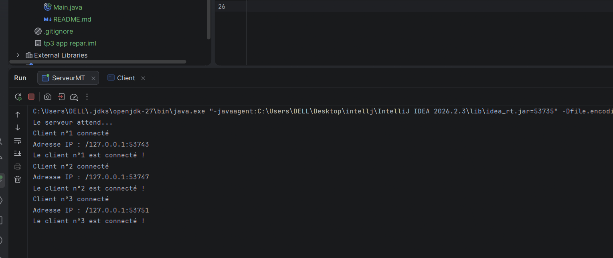

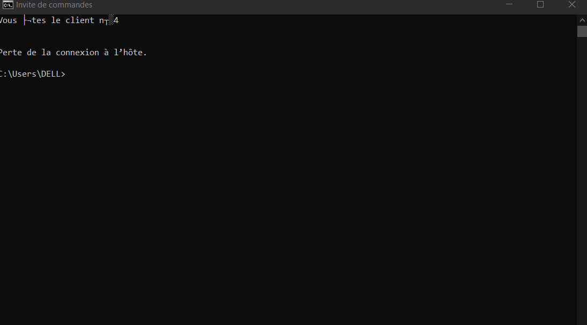

# TP3 – Activité 3-2 : Calculatrice Multi-threads

## 1. Objectif

Améliorer l'application calculatrice du TP2 pour permettre au serveur de gérer plusieurs clients simultanément grâce aux Threads.

## 2. Les classes

- **Operation.java :** contient les données de l'opération.
- **ServeurMT.java :** accepte plusieurs clients et gère le compteur global.
- **ClientProcess.java :** traite les opérations de chaque client.
- **Client.java :** envoie une opération et reçoit le résultat.

## 3. Fonctionnement

1. Démarrer le serveur.
2. Connecter plusieurs clients.
3. Chaque client envoie une opération.
4. Le serveur calcule le résultat et l'envoie au client.
5. Le compteur global augmente après chaque calcul réussi.

## 4. ServeurMT:
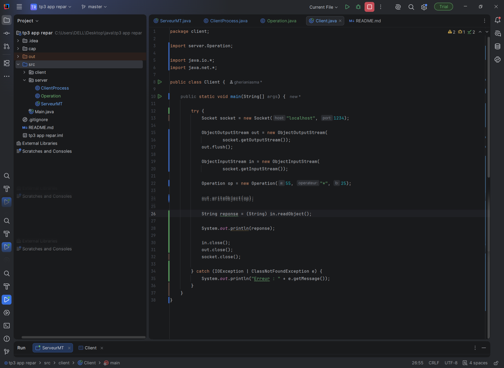

## 5. clientprocess:
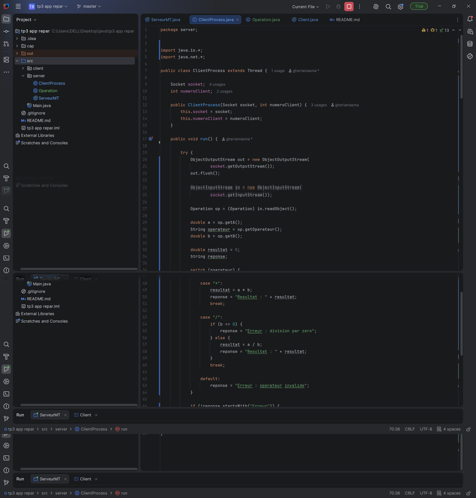

## 6.operation:
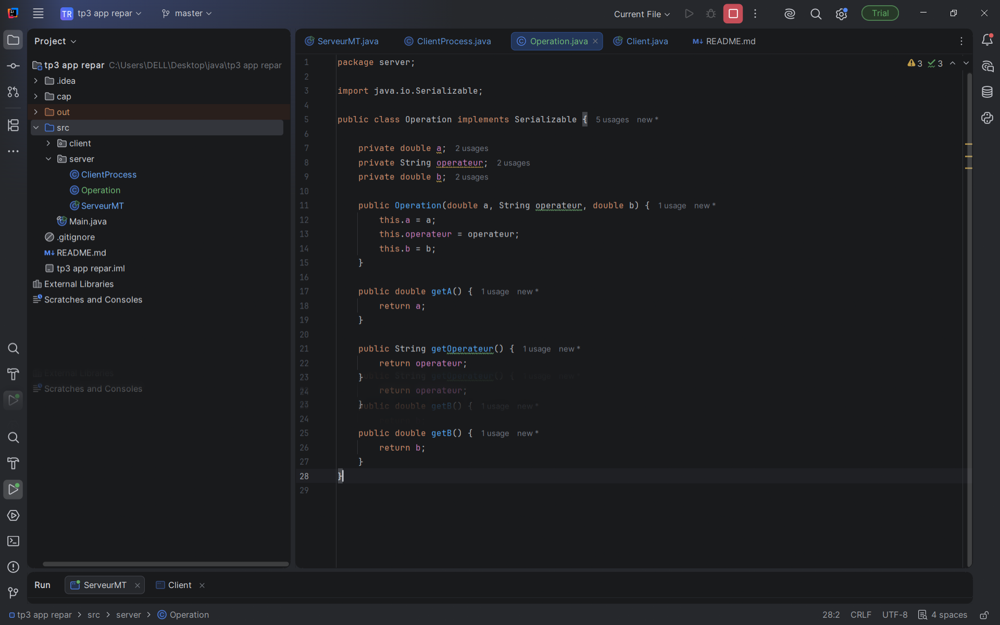

## 7.client:
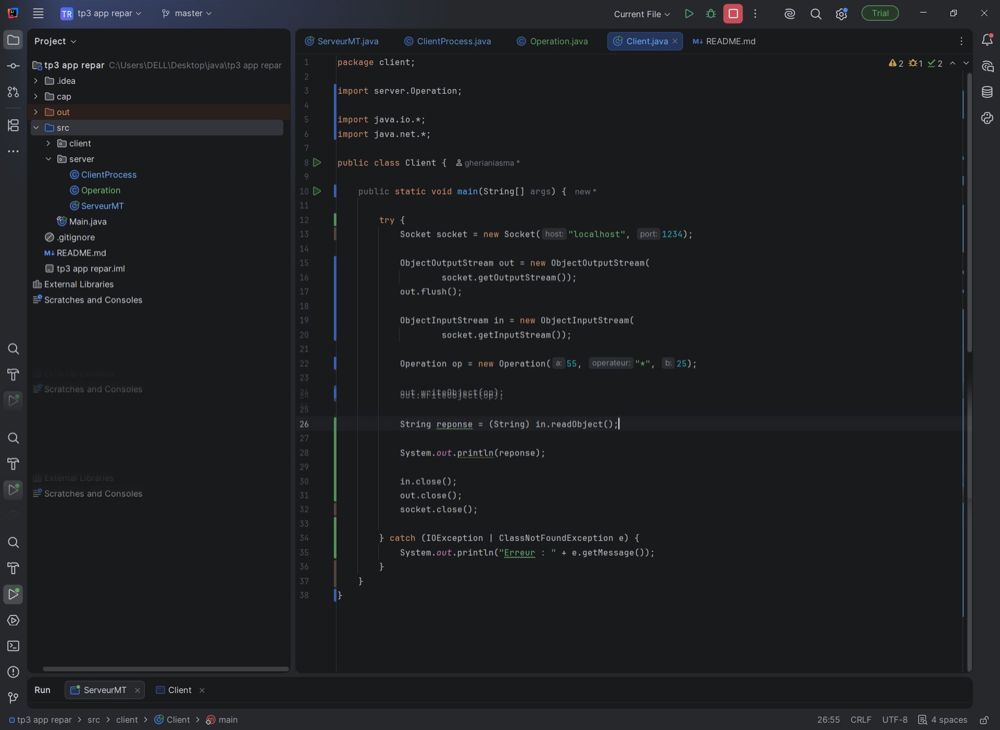

## 8. résultat
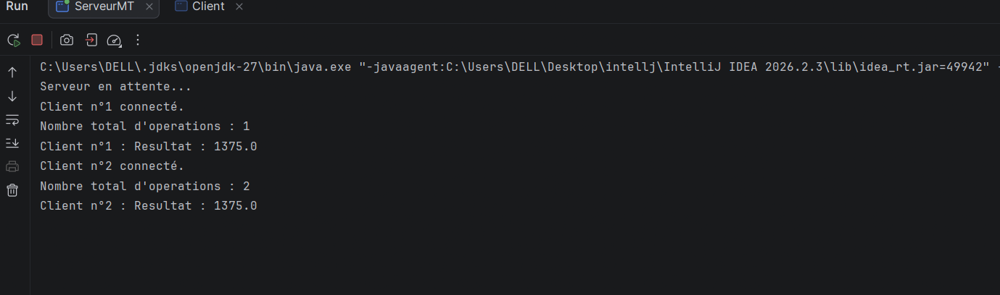

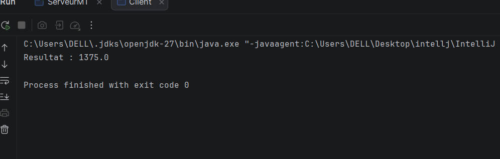

